<p align="center">
  
</p>

<p align="center">
  
  
  
  
  
</p>

<p align="center">
  
  
  
  
  
</p>

# Meridian Diagnostics ML

Perceptron, Logistic Regression, Support Vector Machines and Clustering, all written from scratch in Python.

| Field | Value |
|---|---|
| Author | Abdul Azeem |
| Roll number | 24i-2013 |
| Section | BAI-5A |
| Repository | [AbdulAzeemHashmi/meridian-diagnostics-ml](https://github.com/AbdulAzeemHashmi/meridian-diagnostics-ml) |

---

## Table of Contents

- [Project Overview](#project-overview)
- [See It Move](#see-it-move)
- [Parts Covered](#parts-covered)
- [Main Results](#main-results)
- [Model Parameters](#model-parameters)
- [Datasets](#datasets)
- [File and Folder Structure](#file-and-folder-structure)
- [File and Folder Details](#file-and-folder-details)
- [Playground](#playground)
- [Setup Instructions](#setup-instructions)
- [Running the Notebook](#running-the-notebook)
- [Debugging and Development](#debugging-and-development)
- [Common Issues](#common-issues)
- [Library Constraints](#library-constraints)
- [Known Limitations](#known-limitations)

---

## Project Overview

Meridian Diagnostics is a pathology lab. It checks breast mass samples as benign or malignant, and it reads handwritten digits from sample ID forms. A missed cancer is much worse than a false alarm, so cost matters in every decision.

This project builds the standard linear classifiers and clustering methods by hand, tests them, and then recommends what the lab should use. Only NumPy, pandas and Matplotlib are used. There is no scikit-learn, no scipy and no ready-made classifier anywhere.

<p align="center">
  
</p>

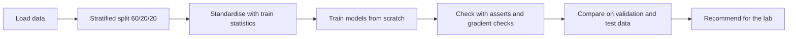

---

## See It Move

These small animations show the two ideas behind the playground. They are plain SVG files, so they need no setup.

<table>
  <tr>
    <td align="center">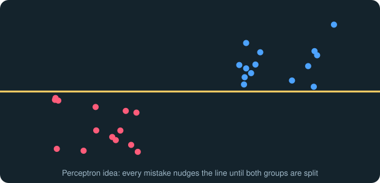</td>
    <td align="center">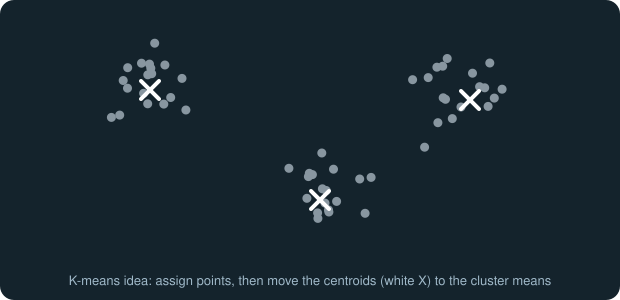</td>
  </tr>
  <tr>
    <td align="center"><b>Perceptron</b><br>The line turns after each mistake.</td>
    <td align="center"><b>K-means</b><br>Centroids move to the middle of their points.</td>
  </tr>
</table>

---

## Parts Covered

| Part | Topic |
|---|---|
|  | Stratified split, standardisation, EDA, PCA by SVD, 8 asserts |
|  | Perceptron, Novikoff bound, averaged and kernel perceptron, multiclass |
|  | Stable loss, gradient check, four optimisers, L1 and L2, cost decisions, softmax |
|  | Pegasos, SMO with KKT and duality gap, kernels, grid search, multiclass SVM |
|  | K-means, GMM with EM, hierarchical, DBSCAN, spectral, metrics |
|  | Comparison tables and clinical recommendation |
|  | Interactive playground with dragging and live numbers |

---

## Main Results

These numbers come from the notebook outputs. Tables 1 and 2 show the mean and standard deviation over 3 stratified splits.

### D1 breast cancer (Table 1)

| Model | Accuracy | Malignant recall | ROC-AUC |
|---|---|---|---|
| Averaged perceptron | 97.35% | 96.03% | 0.9889 |
| L2 logistic regression | 97.94% | 95.24% | 0.9966 |
| L1 logistic regression | 97.94% | 95.24% | 0.9962 |
| Linear SVM (SMO) | 86.73% | 88.89% | 0.9684 |
| RBF SVM (SMO) | 97.94% | 95.24% | 0.9981 |

### Cost rule for the cancer screen

A missed malignant sample costs r = 3 times a false alarm, so the best rule is to predict malignant when the probability p is at least 1 / (1 + r) = 0.25.

| Threshold | Average cost per patient |
|---|---|
| 0.5 | 0.0598 |
| 0.25 | 0.0475 |

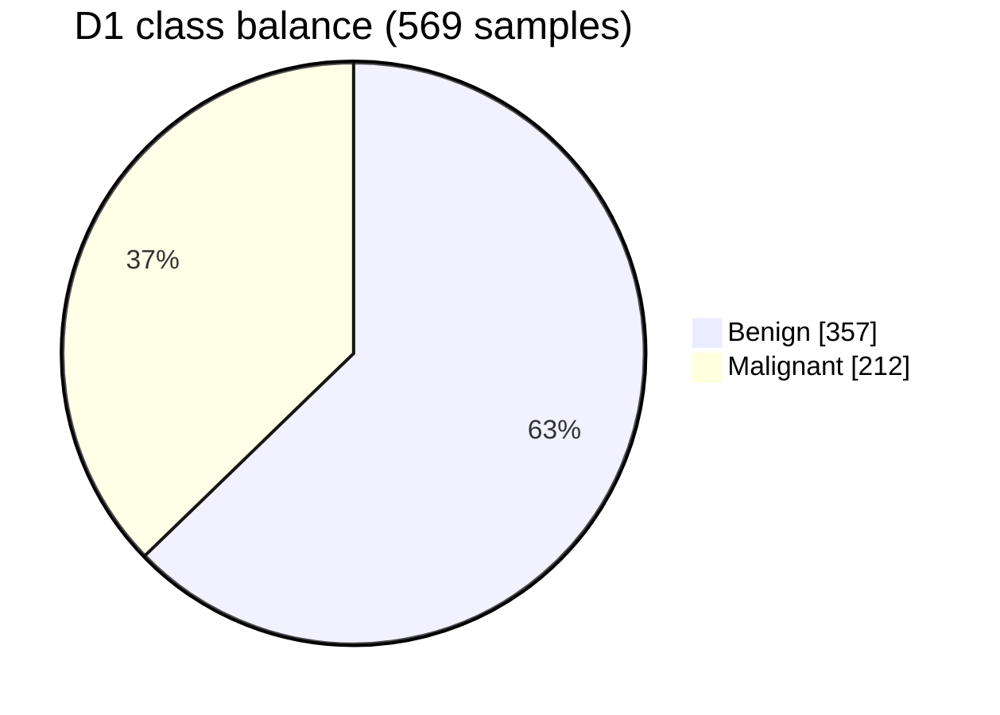

### Clustering ARI (Table 3)

| Method | Moons | Circles | Aniso | Digits-1500 |
|---|---|---|---|---|
| K-means | 0.4570 | -0.0016 | 0.9558 | 0.6599 |
| GMM (EM) | 0.1952 | -0.0013 | 0.6936 | 0.6830 |
| Ward | 0.6719 | 0.0073 | 1.0000 | 0.4645 |
| DBSCAN | 0.0000 | 1.0000 | 0.9699 | 0.0479 |
| Spectral | 0.5820 | -0.0013 | 0.9900 | 0.4208 |

---

## Model Parameters

Seed: **2013**. All random generators are made with `np.random.default_rng(2013 + k)`.

| Parameter | Rule | Value |
|---|---|---|
| seed | roll | 2013 |
| eta | 0.005 x (1 + d4) | 0.02 |
| lam | 0.002 x max(1, d1 + d2 + d3 + d4) | 0.012 |
| C | 2 ^ ((d3 + d4) mod 5 - 2) | 4.0 |
| gamma | 0.02 x (1 + (roll mod 7)) | 0.10 |
| r | 2 + (roll mod 4) | 3 |
| rho | 0.02 x max(1, roll mod 6) | 0.06 |

---

## Datasets

### D1: Breast Cancer Wisconsin Diagnostic

**Source:** [UCI Machine Learning Repository](https://archive.ics.uci.edu/dataset/17/breast+cancer+wisconsin+diagnostic)

**Direct file:** `https://archive.ics.uci.edu/ml/machine-learning-databases/breast-cancer-wisconsin/wdbc.data`

**Local file:** `data.csv`

| Property | Value |
|---|---|
| Total samples | 569 |
| Features | 30 numeric features (columns 3 to 32 of wdbc.data) |
| Classes | Malignant (M) 212 samples, Benign (B) 357 samples |
| Labels for perceptron and SVM | M = +1, B = -1 |
| Labels for logistic regression | M = 1, B = 0 |

**Stratified split:**

| Split | Samples | Benign | Malignant |
|---|---|---|---|
| Train (60%) | 342 | 214 | 128 |
| Validation (20%) | 114 | 72 | 42 |
| Test (20%) | 113 | 71 | 42 |

The test hold-out uses `np.random.default_rng(2013 + 10)`. The train and validation split uses `np.random.default_rng(2013 + 11)`.

### D2: Optical Recognition of Handwritten Digits

**Source:** [UCI Machine Learning Repository](https://archive.ics.uci.edu/dataset/80/optical+recognition+of+handwritten+digits)

**Direct files:**
- `https://archive.ics.uci.edu/ml/machine-learning-databases/optdigits/optdigits.tra`
- `https://archive.ics.uci.edu/ml/machine-learning-databases/optdigits/optdigits.tes`

**Local files:** `optdigits.tra` and `optdigits.tes` (not in the repository, download them separately)

| Property | Value |
|---|---|
| Combined samples | 5620 |
| Features | 64 pixel values (8x8 image, values 0 to 16) |
| Classes | 10 digits (0 to 9) |
| Subset used | digits-1500, a stratified random subset of 1,500 images with `rng(2013 + 6)` |
| Split for tasks | 70% train (1050) and 30% test (450) |

---

## File and Folder Structure

```
meridian-diagnostics-ml/
|
|-- 24i-2013_AbdulAzeem_BAI-5A.ipynb    # Main notebook (all parts and the report)
|-- mlcode.py                           # Shared ML library used by the notebook and playground
|-- playground.py                       # Interactive playground (Part F)
|-- README.md                           # This file
|-- .gitignore                          # Git ignore rules
|
|-- assets/                             # Animated SVG pictures used by this README
|   |-- banner.svg
|   |-- pipeline.svg
|   |-- perceptron_demo.svg
|   |-- kmeans_demo.svg
|   |-- badges/                     # Local SVG badges (no internet needed)
|
|-- screenshots/                        # Required Part F screenshots (7 PNG files)
|   |-- perceptron.png
|   |-- logistic.png
|   |-- svm.png
|   |-- kmeans.png
|   |-- exp1.png
|   |-- exp2.png
|   |-- exp3.png
|
|-- data.csv                            # D1 data (gitignored, download separately)
|-- optdigits.tra                       # D2 training file (gitignored)
|-- optdigits.tes                       # D2 test file (gitignored)
```

---

## File and Folder Details

### `24i-2013_AbdulAzeem_BAI-5A.ipynb`

The main Jupyter notebook. It imports every algorithm from `mlcode.py` and is meant to run from top to bottom.

| Section | Content |
|---|---|
| Cell 1 | Roll number parameters printed |
| Setup | Data loading, stratified split, standardisation, EDA, PCA, 8 asserts |
| Part A | Perceptron, Novikoff bound, averaged, kernel and multiclass perceptron |
| Part B | Stable sigmoid, gradient check, four optimisers, L1 and L2 paths, cost threshold, softmax |
| Part C | Pegasos, SMO, KKT and duality checks, kernels, grid search, multiclass SVM |
| Part D | K-means, GMM with EM, hierarchical, DBSCAN, spectral, metrics |
| Part E | Comparison tables and the recommendation for Meridian |
| Part F | Playground experiment answers with screenshots |
| Report | The 6 section report as the last markdown section |

### `mlcode.py`

NumPy only. Every function has a docstring.

| Group | Functions |
|---|---|
| Part A | `perceptron_train`, `perceptron_predict`, `novikoff_bound`, `averaged_perceptron`, `kernel_perceptron`, `multiclass_perceptron`, `accuracy`, `confusion_matrix`, `precision_recall_f1`, `macro_f1` |
| Part B | `sigmoid`, `softplus`, `lr_objective`, `lr_gradient`, `lr_hessian`, `gradient_check`, `gd`, `sgd`, `momentum_gd`, `newton`, `soft_threshold`, `ista`, `kfold_stratified`, `cross_val_lambda`, `roc_curve`, `auc_ranksum`, `auc_trapezoid`, `expected_cost`, `softmax`, `softmax_regression` |
| Part C | `hinge_objective`, `pegasos`, `svm_dual_objective`, `smo_train`, `kkt_violations`, `duality_gap`, `linear_kernel`, `poly_kernel`, `rbf_kernel`, `grid_search_cv`, `one_vs_rest`, `one_vs_one` |
| Part D | `kmeans_pp_init`, `kmeans`, `logsumexp`, `gmm_em`, `bic`, `agglomerative`, `cut_tree`, `draw_dendrogram`, `dbscan`, `k_distance`, `spectral_clustering`, `ari`, `nmi`, `silhouette` |

### `playground.py`

A point and click visualiser built with NumPy and Matplotlib events. It imports from `mlcode.py`. Run it from a terminal, not inside Jupyter.

### `generate_screenshots.py`

A helper that draws the 7 screenshots without a display (Agg backend). It writes the PNG files into `screenshots/`.

### `assets/`

Four small animated SVG files and a `badges/` folder with 17 local SVG badges. They are only used to make this README look good and are not needed to run the project. The badges are stored in the repo on purpose, so they never show as broken images.

### `screenshots/`

Seven PNG files for Part F.

| File | Content |
|---|---|
| `perceptron.png` | Perceptron boundary on a separable 2-D set |
| `logistic.png` | Logistic regression boundary after gradient descent |
| `svm.png` | SVM with boundary, dashed margin lines and circled support vectors |
| `kmeans.png` | K-means clusters with X markers for the centroids |
| `exp1.png` | One wrong-class point inside a group |
| `exp2.png` | XOR pattern, where a linear model fails |
| `exp3.png` | Three thin stripes, where K-means fails |

---

## Playground

Start it from a terminal:

```bash
python playground.py
```

A window opens with the axes fixed to [-5, 5] x [-5, 5].

### Controls

| Key or action | Effect |
|---|---|
| Left click | Add a blue point (class +1) |
| Right click | Add a red point (class -1) |
| `p` | Perceptron mode |
| `l` | Logistic regression mode |
| `s` | SVM mode |
| `k` | K-means mode |
| `space` | Do one step of the chosen model |
| `2` to `6` | Set K for K-means |
| `r` | Reset the model |
| `u` | Remove the last point |
| `c` | Clear all points |
| Click and drag | Move a point. SVM and logistic regression update when you release the mouse |

### Numbers shown in the plot title

| Model | Title shows |
|---|---|
| Perceptron | Epoch number and mistakes in the last epoch |
| Logistic regression | Iteration number and loss |
| SVM | Number of support vectors and margin width |
| K-means | K, iteration number and inertia |

### Screenshot gallery

<table>
  <tr>
    <td align="center">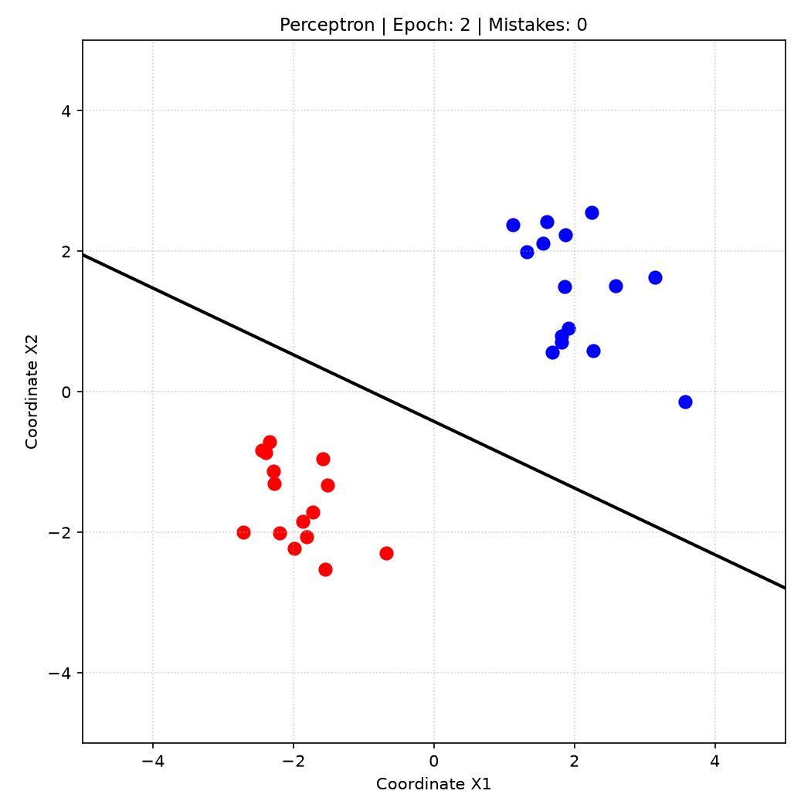<br><b>Perceptron</b></td>
    <td align="center">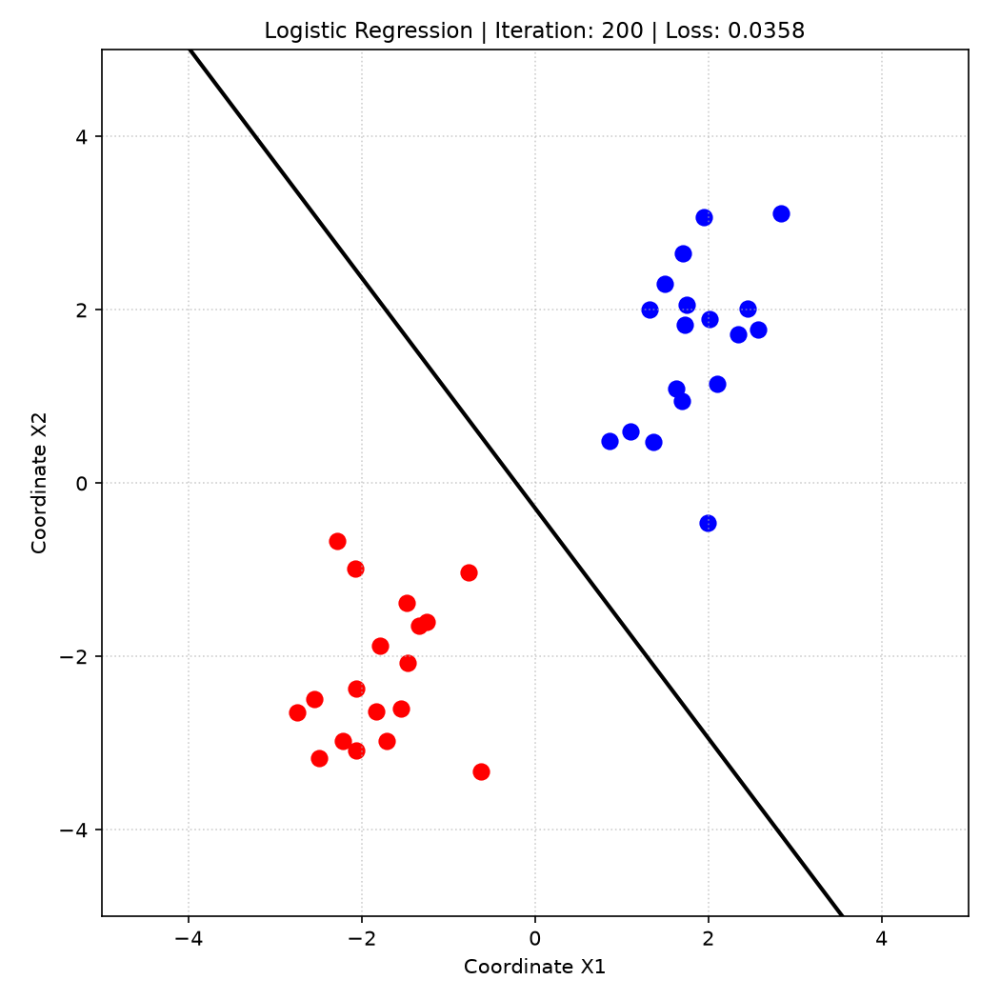<br><b>Logistic regression</b></td>
    <td align="center">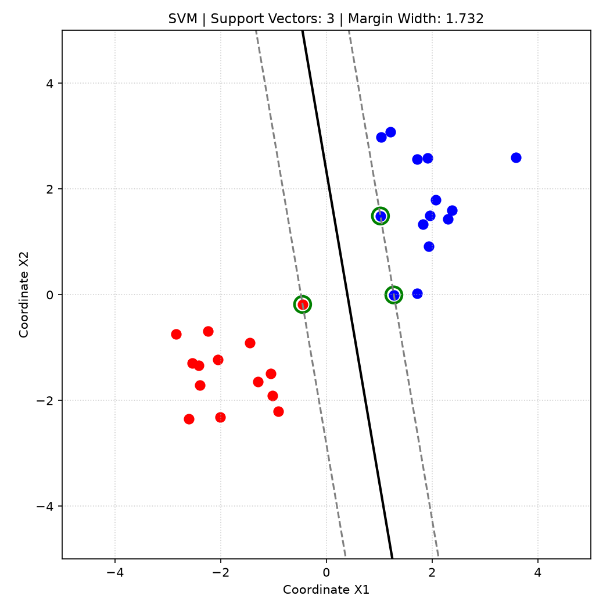<br><b>SVM</b></td>
    <td align="center">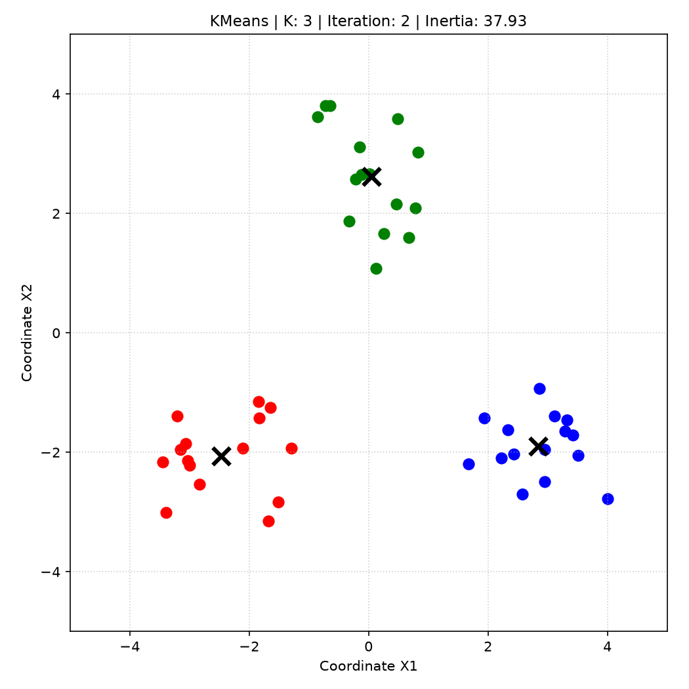<br><b>K-means</b></td>
  </tr>
  <tr>
    <td align="center">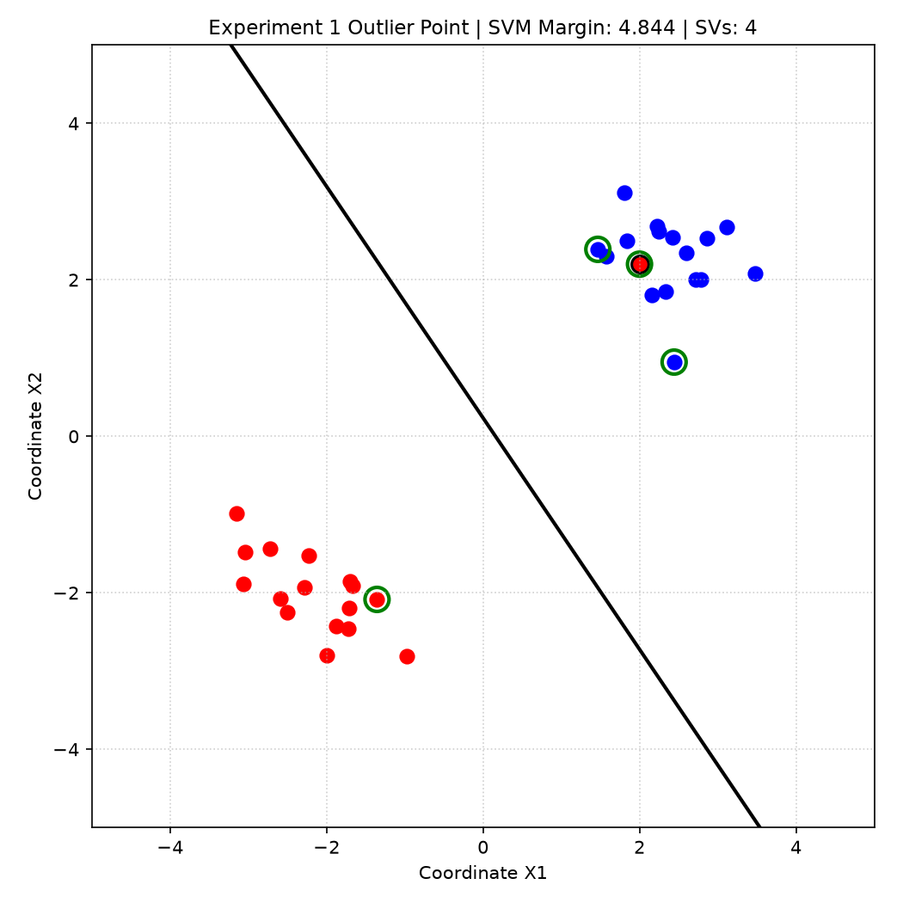<br><b>Experiment 1</b><br>Outlier point</td>
    <td align="center">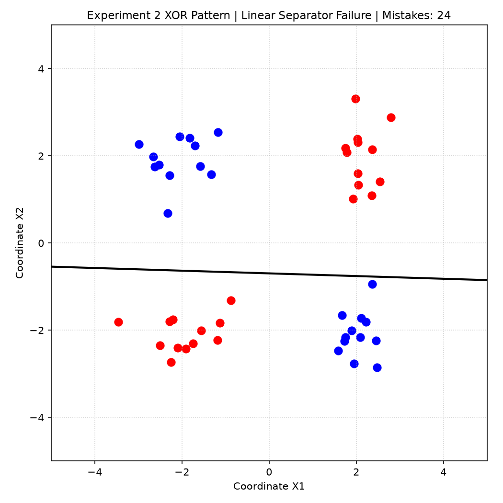<br><b>Experiment 2</b><br>XOR pattern</td>
    <td align="center">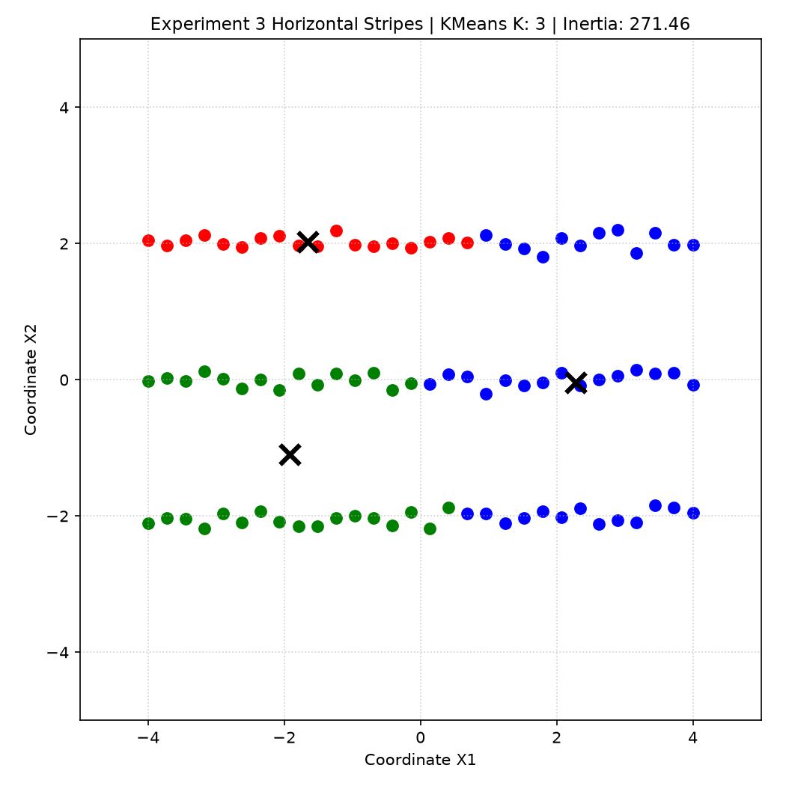<br><b>Experiment 3</b><br>Thin stripes</td>
    <td></td>
  </tr>
</table>

---

## Setup Instructions

### 1. Clone the repository

```bash
git clone https://github.com/AbdulAzeemHashmi/meridian-diagnostics-ml.git
cd meridian-diagnostics-ml
```

### 2. Install the packages

```bash
pip install numpy pandas matplotlib jupyter nbclient nbformat
```

### 3. Download the datasets (they are not in the repository)

**D1 Breast Cancer Wisconsin:**

```bash
curl -L -o wdbc.data https://archive.ics.uci.edu/ml/machine-learning-databases/breast-cancer-wisconsin/wdbc.data
```

The file `wdbc.data` has no header row. Column 1 is an ID, column 2 is the diagnosis and columns 3 to 32 are the features. The notebook loads it as `data.csv` with column names added.

**D2 Optical Digits:**

```bash
curl -L -o optdigits.tra https://archive.ics.uci.edu/ml/machine-learning-databases/optdigits/optdigits.tra
curl -L -o optdigits.tes https://archive.ics.uci.edu/ml/machine-learning-databases/optdigits/optdigits.tes
```

---

## Running the Notebook

Open it in Jupyter:

```bash
jupyter notebook 24i-2013_AbdulAzeem_BAI-5A.ipynb
```

Or in JupyterLab:

```bash
jupyter lab 24i-2013_AbdulAzeem_BAI-5A.ipynb
```

Run everything from top to bottom without opening it:

```bash
jupyter nbconvert --to notebook --execute 24i-2013_AbdulAzeem_BAI-5A.ipynb --output 24i-2013_AbdulAzeem_BAI-5A_executed.ipynb
```

Export to PDF or HTML:

```bash
jupyter nbconvert --to pdf 24i-2013_AbdulAzeem_BAI-5A.ipynb
jupyter nbconvert --to html 24i-2013_AbdulAzeem_BAI-5A.ipynb
```

To make the screenshots without a display:

```bash
python generate_screenshots.py
```

---

## Debugging and Development

Quick checks you can paste into a terminal.

**Import and perceptron check**

```bash
python -c "import mlcode as ml, numpy as np; rng = np.random.default_rng(42); X = rng.standard_normal((60, 4)); y = np.where(X[:, 0] > 0, 1, -1); w, b, h, ep = ml.perceptron_train(X, y); print('perceptron ok, epochs:', ep)"
```

**Gradient check (the error should be below 1e-6)**

```bash
python -c "import mlcode as ml, numpy as np; rng = np.random.default_rng(42); X = rng.standard_normal((40, 5)); y = rng.integers(0, 2, 40).astype(float); err = ml.gradient_check(np.zeros(5), 0.0, X, y, lam=0.01); print('Gradient error:', err)"
```

**Sigmoid and softplus at extreme values**

```bash
python -c "import mlcode as ml, numpy as np; z = np.array([-1000.0, 0.0, 1000.0]); print('sigmoid:', ml.sigmoid(z)); print('softplus:', ml.softplus(z))"
```

**SMO on a small set**

```bash
python -c "import mlcode as ml, numpy as np; rng = np.random.default_rng(42); X = rng.standard_normal((30, 2)); y = np.where(X[:, 0] > 0, 1, -1); alpha, b, dh, _ = ml.smo_train(X, y, C=1.0, kernel_func=ml.linear_kernel, max_passes=5); print('SMO ok, support vectors:', int(np.sum(alpha > 1e-4)))"
```

**K-means inertia never goes up**

```bash
python -c "import mlcode as ml, numpy as np; rng = np.random.default_rng(2013); X = rng.standard_normal((100, 2)); cents, lbls, inrt, hist = ml.kmeans(X, K=4, n_init=3, rng=rng); assert all(d <= 1e-8 for d in np.diff(hist)), 'Inertia went up'; print('Inertia check passed. Final inertia:', inrt)"
```

**ARI is 1 for permuted labels**

```bash
python -c "import mlcode as ml, numpy as np; rng = np.random.default_rng(42); lbls = rng.integers(0, 3, 100); perm = np.where(lbls==0, 2, np.where(lbls==2, 0, lbls)); score = ml.ari(lbls, perm); print('ARI:', score); assert abs(score - 1.0) < 1e-6"
```

**Run notebook cells one by one**

```bash
jupyter console 24i-2013_AbdulAzeem_BAI-5A.ipynb
```

**Profile a slow function**

```bash
python -c "import cProfile, mlcode as ml, numpy as np; rng = np.random.default_rng(2013); X = rng.standard_normal((200, 10)); y = np.where(X[:, 0] > 0, 1, -1); cProfile.run('ml.smo_train(X, y, C=1.0, kernel_func=ml.linear_kernel, max_passes=3)')"
```

---

## Common Issues

| Problem | Cause | Fix |
|---|---|---|
| `ModuleNotFoundError: mlcode` | The notebook and `mlcode.py` are in different folders | Start Jupyter from the project root folder |
| `FileNotFoundError: data.csv` | D1 is not downloaded | Follow the dataset steps above |
| Playground shows a blank window | It was started inside Jupyter with inline plots | Run `python playground.py` from a terminal |
| Matplotlib cache warning | No write access to the `.matplotlib` folder | On Windows run `set MPLCONFIGDIR=%TEMP%` |
| SMO is very slow | The kernel matrix grows with the square of the sample count | Use smaller `max_iter` and `max_passes` while developing |
| Notebook does not run top to bottom | Old output from a partial run | Use Kernel, then Restart and Run All |
| SVM on digits gives about 10% accuracy | gamma 0.1 is too large for raw pixels from 0 to 16, so the kernel matrix is almost the identity | Scale pixels to [0, 1] or use a much smaller gamma |

---

## Library Constraints

**Allowed**
- `numpy` (including `numpy.linalg`) for all model computation
- `pandas` for loading and showing data
- `matplotlib` and `seaborn` for plots
- Python standard library: `math`, `time`, `collections`, `itertools`

**Not used (written from scratch instead)**
- `scikit-learn`
- `scipy`
- `statsmodels`
- Any ready-made classifier, optimiser, QP solver, clustering function, kernel, metric, cross-validation or PCA function

PCA uses `numpy.linalg.svd`. Eigen problems use `numpy.linalg.eigh`. Distance and kernel matrices are vectorised with NumPy.

---

## Known Limitations

Being honest about what is not perfect yet:

- The one-vs-one and one-vs-rest RBF SVM on digits-1500 score about 10%, which is chance level. The likely reason is the gamma value on unscaled pixels.
- The linear kernel check of the kernel perceptron against the primal perceptron shows a weight difference of about 1.49, but it should be close to 0.
- Linear SVM (SMO) is unstable across splits in Table 1 (86.73% mean accuracy with a large spread).
- Only 3 random splits are used, so small differences between models are not strong evidence.
- Datasets are small (569 samples for D1, 113 in the test set).

---

<p align="center">
  Built by <b>Abdul Azeem</b> for Machine Learning Assignment 3.
</p>
